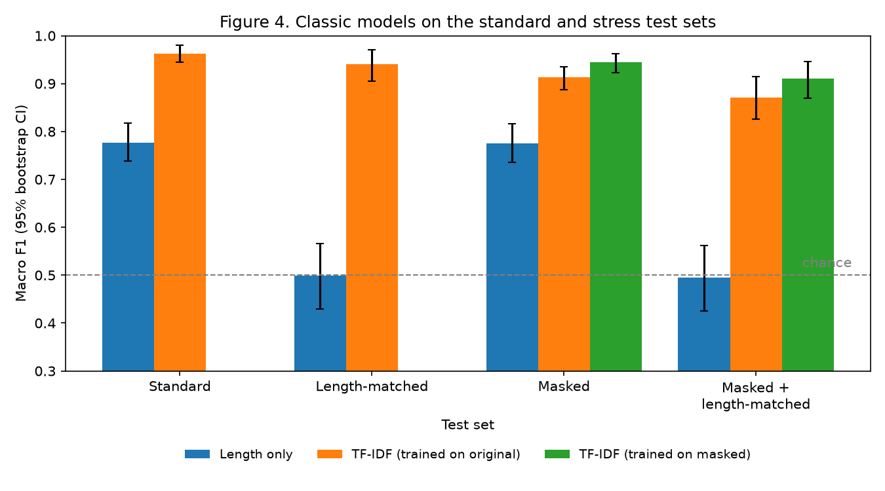

# What Does a Filipino Fake News Classifier Learn?

Fake news classifiers for Filipino report accuracies above 90% on the Fake News Filipino corpus
(Cruz et al., 2020). This project asks whether those scores come from the content of the articles or
from shortcuts, such as the year an article was written, how long it is, or the website it came from.
Each model is scored on the standard test set and on stress test sets that remove those shortcuts.

**Status.** Work in progress. The classic baselines and stress tests are done. The fine-tuned Tagalog
RoBERTa and the LoRA-tuned small LLM are next.

## Data

The corpus has 3,206 Tagalog news articles, half labelled real and half fake. Real articles come from
tabloid news sites (Abante, Bandera, Pilipino Star Ngayon). Fake articles come from sites flagged by
Vera Files and the National Union of Journalists of the Philippines. The data is downloaded at run
time from a pinned Hugging Face revision. The dataset has no stated license, so this repo does not
store a copy.

Three problems were found before any model was trained.

1. **Duplicates.** 201 rows repeat an earlier article. They are removed before splitting, which leaves
   3,005 unique articles. Without this step, the same article can appear in both the training and test
   sets.
2. **Length.** Fake articles have a median of 229 words and real articles 84. Logistic regression on
   article length alone reaches 0.777 macro F1.
3. **Time period.** Real articles mostly mention the years 2012 to 2015 and fake articles 2016 to
   2019. Year tokens and politician names are among the strongest features of the baseline.

The unique articles are split 70/15/15 into train (2,103), validation (451), and test (451),
stratified by label with seed 42. Every notebook checks a hash of the test set so that all models are
scored on the same articles.

## Stress tests

Two harder test sets are built from the same 451 test articles.

- **Length-matched** (202 articles). Inside each of 10 length bins, real and fake articles are
  subsampled to equal counts. Length then carries no information about the label.
- **Masked** (451 articles). Numbers and years become `xxnum`. Capitalized words that do not start a
  sentence become `xxname`. URLs and platform words such as *video*, *facebook*, and *panoorin* (watch)
  are removed, and the text is lowercased.

A third set applies both. Macro F1 is the unweighted mean of the F1 scores of the two classes, so
random guessing scores about 0.50.

## Results so far

| Model | Standard | Length-matched | Masked | Masked + length-matched |
|---|---|---|---|---|
| Length only | 0.777 | 0.499 | 0.775 | 0.495 |
| TF-IDF + LR, trained on original text | 0.962 | 0.941 | 0.913 | 0.871 |
| TF-IDF + LR, trained on masked text | | | 0.945 | 0.911 |

*Table 1. Test macro F1. The 95% bootstrap intervals are in `results/metrics_stress_tests_classic.csv`.
On the 202-article sets the intervals are about 0.09 wide.*



The shortcuts explain part of the score, but less than expected. Removing length, years, names, and
platform words lowers the baseline from 0.962 to 0.871. A model trained on masked text recovers to
0.911.

The features that remain are mostly about register, the style in which an article is written. The
strongest cues for *fake* are the hearsay markers *daw* and *umano* (reportedly, allegedly), direct
address to the reader such as *kababayan natin* (our countrymen), the polite particle *po*, and words
like *netizens* and *reaksyon*. The strongest cues for *real* are attribution phrases such as *sinabi
ni* (said by) and the police report phrase *dakong* (at around, before a time). A classifier on this
corpus therefore learns to tell a conversational social media register apart from tabloid reporting.
That signal is useful, but it is not the same as checking whether a claim is true.

## Next steps

1. Fine-tune `jcblaise/roberta-tagalog-base` and score it on all four test sets.
2. Compare zero-shot prompting with LoRA fine-tuning of `Qwen/Qwen2.5-1.5B-Instruct` on the same sets.
3. Test whether the larger models depend more or less on register cues than the TF-IDF baseline.

## Repository layout

```
fakenews_data.py                      loading, split, length matching, masking
notebooks/01_data_and_baseline.ipynb  duplicates, split, TF-IDF + LR baseline
notebooks/02_shortcut_stress_tests.ipynb
results/                              metrics CSVs and figures
```

The classic notebooks run on a laptop CPU in under a minute. The transformer notebooks are written
for a Google Colab T4 GPU.

## Reference

Cruz, J. C. B., Tan, J. A., and Cheng, C. (2020). Localization of Fake News Detection via Multitask
Transfer Learning. *Proceedings of the 12th Language Resources and Evaluation Conference*, 2596 to 2604.
